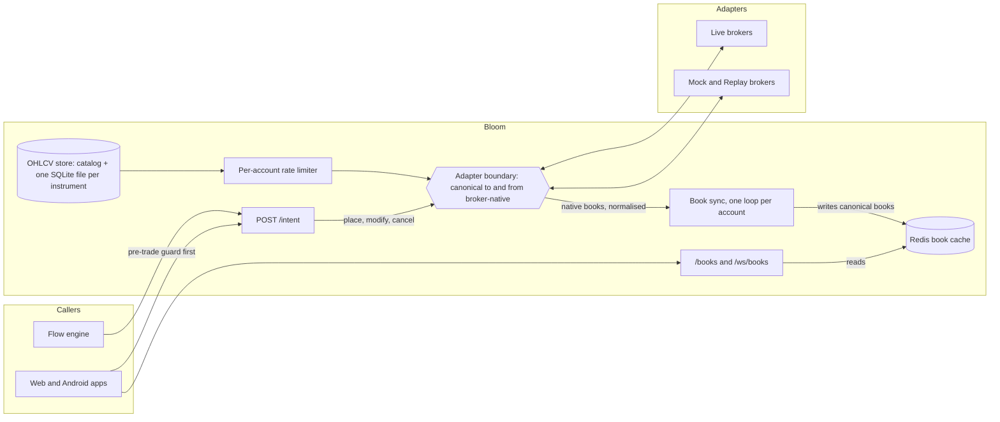

# Multi-broker trading infrastructure

By ash · [github.com/ash-0001](https://github.com/ash-0001)

This folder shows the engineering behind a private trading stack: how it is put together and what it measures. The platform's code is closed-source and its strategy logic is withheld. There are no signals, parameters, trade data or returns here.

[`portfolio.html`](portfolio.html) is the full write-up, including two more projects. GitHub shows HTML files as source, so download it and open it in a browser.

## The problem

Indian retail brokers expose the same concepts through incompatible APIs. Kotak calls the NSE cash segment `nse_cm`, Upstox and Dhan call it `NSE_EQ`, and 5paisa splits it into two fields, `N` and `C`. Order states, timestamps and tick feeds disagree in the same way. Code built directly on those APIs ends up special-casing brokers everywhere, and a strategy or backtest written against one broker doesn't carry over to the next.

## What I built

Two services, with the disagreement absorbed once at an adapter boundary:

- **Bloom** is the intent-trading server. Callers get one URL and one payload shape, whichever broker is behind the account.
- **Flow** is a durable graph engine that runs trading workflows as checkpointed DAGs, live or on a virtual clock.

## Architecture

| Layer | How it works |
|---|---|
| Data pipeline | Gap-detecting history fetches under per-broker, per-account rate limits. Stored per instrument, with bad-bar re-fetch and split detection. Live ticks arrive through one shape from every broker's feed. |
| Execution | One intent schema, broker adapters behind a trait, and cache-first books kept warm by background sync with exponential backoff. |
| Risk controls | A day-level governor (loss limit, profit target, trade count, time window), a final pre-trade guard that checks the raw broker order book, position liquidation, and reconciliation against the position cap. |
| Backtesting | The same flow runs on a virtual clock with isolated state and a simulated broker. It cannot reach a real broker, and each trading day can run in parallel. |
| Strategy | **Withheld.** |

## In numbers

Measured on 30 and 31 October 2026 from the private repos' git history and test runs, except where noted.

| | Bloom | Flow |
|---|---|---|
| Rust | 50,543 lines | 84,005 lines, excluding the private strategy engine |
| Commits | 290 | 450 on main |
| Rust tests | 414 passing, 15 ignored | 1,077 passing, 23 failing, 3 ignored (working branch, run serially, strategy engine's tests left out) |
| Surface | 11 adapters: 7 live brokers, 1 data feed, 3 simulators; 160 HTTP routes | 70+ node modules |

## License

All rights reserved.
